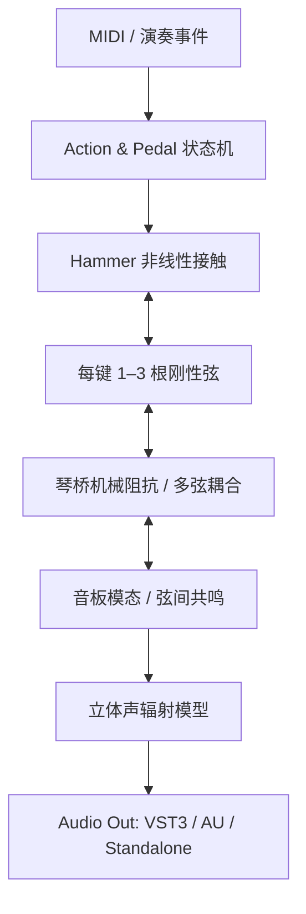

# Aether Piano — 高真实度物理建模钢琴开发总纲

> 文档版本：1.0（2026-10-30） · 项目状态：研究与工程设计阶段 · 语言：中文  
> 目标：研发原创、可实时演奏的三角钢琴物理建模 VST3/AU/Standalone 音源，在声学真实感、力度连续性、踏板共鸣及可演奏性方面逐步逼近高端商业物理建模钢琴的体验。**非 Pianoteq 的代码或专有模型复刻**。

## 先读这五篇

1. [项目目标与范围](docs/00_项目目标与边界.md) — 理想目标和不承诺事项。
2. [技术决策与架构图](docs/01_技术栈与系统架构.md) — Mermaid 模块/数据流/线程图。
3. [物理模型与算法](docs/02_物理声学模型.md)、[DSP 算法设计](docs/03_DSP算法与数值稳定.md) — 核心公式和实现次序。
4. [研究、录音和参数拟合](docs/04_研究计划与数据标定.md) — 如何量化真实度。
5. [完整路线图与质量门](docs/06_阶段路线图与验收门.md) — 如何按阶段开发。

## 资料导航

| 类型 | 文档 | 用途 |
|---|---|---|
| 目标 | [00 项目目标](docs/00_项目目标与边界.md) | 成功标准、取舍原则、范围 |
| 架构 | [01 系统架构](docs/01_技术栈与系统架构.md) | 技术栈、Mermaid 图、实时线程 |
| 物理 | [02 物理声学模型](docs/02_物理声学模型.md) | 琴槌/琴弦/琴桥/音板/制音器模型 |
| DSP | [03 数值与 DSP](docs/03_DSP算法与数值稳定.md) | 采样离散化、滤波、稳定性、替代算法 |
| 实验 | [04 研究与标定](docs/04_研究计划与数据标定.md) | 录音方案、目标函数、盲听 |
| 文献 | [05 论文与参考](docs/05_参考论文与技术资料.md) | 原始论文、官方文档、阅读顺序 |
| 计划 | [06 路线图](docs/06_阶段路线图与验收门.md) | P00–P11 阶段、依赖、通过门 |
| 验收 | [07 测试矩阵](docs/07_测试与量化验收.md) | 单元、声学、性能、插件验证 |
| 工程 | [08 工程规范](docs/08_工程规范与目录.md) | C++ / CMake / CI / RT 安全 |
| 数据 | [09 参数与数据格式](docs/09_参数模式与预设规范.md) | note parameter schema、数据版本 |
| 风险 | [10 风险及决策](docs/10_风险成本与决策记录.md) | 技术债、许可、商业化 |
| 版本 | [11 发布与产品](docs/11_产品能力与发布标准.md) | GUI、功能表、发布验证 |
| Codex | [Codex 总控](codex/README.md) | 运行与交付协议 |
| 指令 | [P00](codex/P00_项目基础与工具链.md) 至 [P11](codex/P11_发布候选与复测.md) | 每阶段独立指令（可复制） |
| 模板 | [AGENTS.md](AGENTS.md) | Codex 自动读取的项目规则 |
| 模板 | [实验日志](templates/EXPERIMENT_LOG.md)、[阶段报告](templates/PHASE_REPORT.md)、[ADR](templates/ADR_TEMPLATE.md) | 决策及结果可追踪 |

## 总体物理链路



> Mermaid 可在 GitHub 或支持 Mermaid 的 Markdown 阅读器中渲染；它是可编辑的文本图，不是图片。

## 推荐执行顺序

1. 将整个文档包复制到新仓库根目录。
2. 打开 `codex/README.md`，检查依赖、机器平台、目标宿主和许可策略。
3. `git init`，按 [P00](codex/P00_项目基础与工具链.md) 启动 Codex。阶段完成后生成报告并提交一个可回滚的 commit。
4. 只有满足该阶段的验收门才进入下一阶段；不允许 Codex 声称“没运行但测试通过”。
5. **先做离线单音声学正确性，再做 88 键、双向耦合、GUI 和发布。**

## 已设计与未完成

这是一套**文档、研究计划和 Codex 阶段任务书**；当前没有实施、编译或验证对应的 VST3 插件，也没有实测钢琴录音。文档中的 CPU、音色和工期指标均为候选目标，必须在指定硬件及参考数据上验证。

## 技术选型基线

- C++20 + CMake ≥3.22 + JUCE 9（锁定已验证的具体 tag/commit；JUCE 9 在 2026 年已发布）。
- Python 3 + NumPy/SciPy + soundfile 或 scipy.io.wavfile，用于离线基准、参数估计和报告。
- 首版 48 kHz / 32-bit float，随后支持常用采样率和宿主任意块大小；128/64 样本块专门压测。
- 跨平台 VST3 + Standalone；AU 仅在 macOS 构建。
- DSP 对外暴露最小稳定接口，不依赖 JUCE GUI；独立参考求解器用于检查声学算法。

## P01 离线参考模型

准备 Python 依赖并生成 C4 参考 WAV、接触力曲线和收敛图：

```sh
uv venv .venv --python python3.14
uv pip install --python .venv/bin/python -r requirements-p01.txt
.venv/bin/python tools/analyzer/reference_solver/run_experiments.py
```

CTest 会运行参考求解器单测；配置时将 `Python3_EXECUTABLE` 指向 `.venv/bin/python`，例如 `-DPython3_EXECUTABLE="$PWD/.venv/bin/python"`。详细结果与复现命令记录在 `experiments/P01/PHASE_REPORT.md`。

## 文献与许可证说明

主要来源为 [Balázs Bank 等研究](docs/05_参考论文与技术资料.md) 与 Julius O. Smith 的《Physical Audio Signal Processing》，并依据 JUCE/Codex/Steinberg 官方文档制定工程要求。文献的理论可供学习；实际代码、参考录音和产品资源仍需核对版权与使用权。
