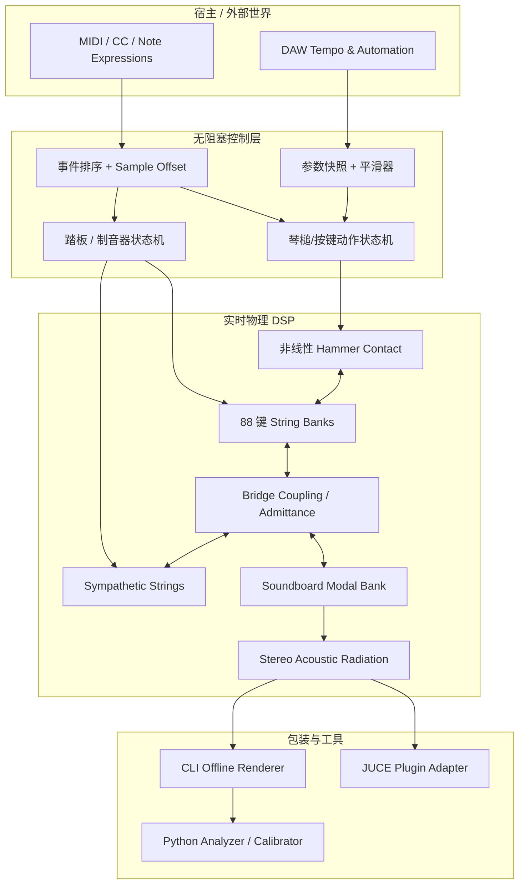
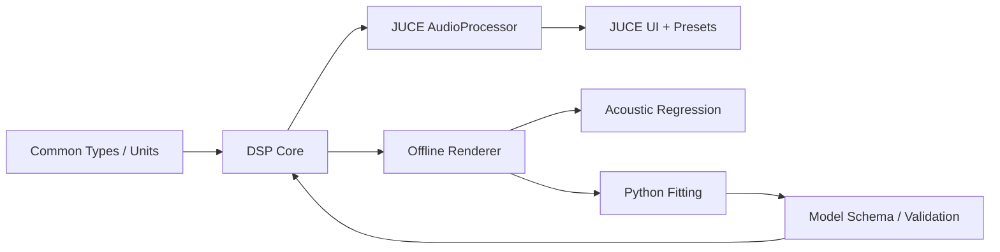
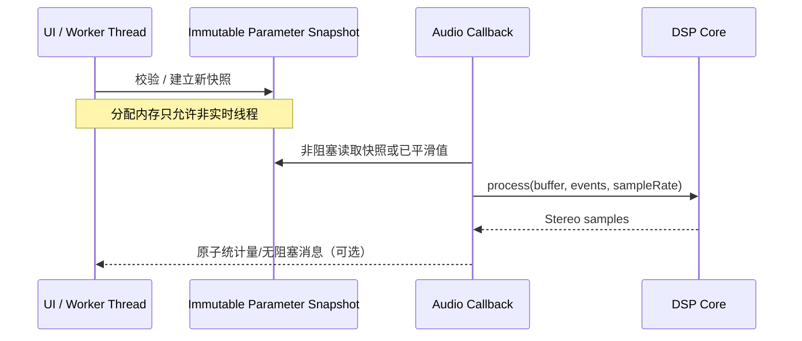

# 01｜技术栈、组件架构和线程设计

## 技术栈

| 层 | 技术 | 理由 |
|---|---|---|
| 物理/DSP 核心 | C++20（无 JUCE 依赖） | 实时可控，CLI 与插件复用 |
| 构建 | CMake ≥ 3.22, CTest, Ninja/MSVC/Xcode | 可重复构建、跨系统 |
| 插件 | JUCE 9，VST3/Standalone；macOS 下 AU | 宿主和参数基础设施 |
| 标定 | Python, NumPy, SciPy, Matplotlib, soundfile | 可解释、可测量、可优化 |
| 文件 | JSON 版本化模型参数；WAV/FLAC 参考 | 可审计、易迁移 |
| CI | GitHub Actions 或等价本地流程 | 构建、单测、静态分析 |
| 验证 | CTest、ASan/UBSan（离线）、pluginval、Steinberg VST3 Validator | 数值与宿主稳定性 |

具体依赖版本由 P00 锁定，不得自动更新主分支。

## 总体架构图



### 关键点

1. `Action` 转换键盘速度和按键/释放事件成琴槌与制音器的初始/目标条件，不直接生成声音。
2. 琴槌接触与振动弦必须按受力和位移/速度双向耦合，不能先合成声波再附加滤波模拟力度。
3. 琴桥和音板对弦的**机械负载**与辐射是两个不同物理角色。可以在早期简化为分离模型，但最终目标要解释能量方向。
4. `Analyzer` 永不进入音频线程。外部工具可以在离线渲染结束后计算频谱和成本。

## 模块依赖图



## 线程与缓冲所有权



**重要：** 快照交换需要无阻塞且**安全的生命周期管理**（例如预分配的双缓冲、SPSC 带序号协议或经过证明的无实时释放方案）。简单交换 `shared_ptr` 并在 callback 中析构旧对象，可能在音频线程上触发释放，不满足 RT 安全。

## 核心接口建议（契约，非已实现代码）

```cpp
struct MidiEvent {
    uint32_t sampleOffset;
    uint8_t status, data1, data2;
};

class PianoEngine {
public:
    void prepare(double sampleRate, uint32_t maximumBlockSize);
    void reset() noexcept;
    void process(float* left, float* right,
                 uint32_t samples,
                 std::span<const MidiEvent> events) noexcept;
};
```

事件必须按 `sampleOffset` 稳定排序并在块内逐样本/分段准确施加；宿主报告的可变块尺寸和采样率变化要明确处理。`process()` 的前置条件由 `prepare()` 检查，实时路径中不抛异常。

## 建议仓库结构

```text
AetherPiano/
  AGENTS.md
  CMakeLists.txt
  cmake/
  external/JUCE/                # 锁定 commit 的 submodule
  src/common/                  # 物理单位、SIMD 设施、事件
  src/model/                   # 参数、预设解析与校验（非 RT）
  src/dsp/                     # 不依赖 JUCE 的物理引擎
    hammer/ string/ bridge/ soundboard/ damper/ radiation/
  src/performance/             # 琴键/踏板/复音状态机
  src/plugin/                  # JUCE AudioProcessor 和 GUI
  tools/offline_render/        # 离线渲染 CLI
  tools/analyzer/              # Python 分析与拟合
  data/models/                 # 参数与来源元数据
  data/manifests/              # 参考录音的清单，不含未授权素材
  tests/unit/ tests/acoustics/ tests/performance/
  docs/                        # 本文档集
  codex/                       # 阶段任务
  experiments/                 # 数据摘要和测试报告
```

## 双向耦合的工程路线

- V0：单弦 + 简化固定端/耗散，验证接触稳定。
- V1：按物理阻抗配置多弦终端；桥侧散射网络满足无源性约束。
- V2：将音板动态导纳加入桥口（或经无源网络近似），避免未受控的代数环；显式区分“桥口机械反馈”和“音板声辐射”。
- V3：多级计算精度与共鸣裁剪策略（应保留能量和一致性约束）。

## 构建契约

- Release、Debug 均可构建；Debug 测数值与边界；Release 测实时性能。
- Windows 和 macOS 首选；Linux VST3/Standalone 可列为扩展；AU 只在 macOS。
- 不把 GUI、音频数据文件读取或频谱分析引入实时处理路径。

来源：JUCE [CMake API](https://github.com/juce-framework/JUCE/blob/master/docs/CMake%20API.md)，Steinberg [VST3 SDK](https://github.com/steinbergmedia/vst3sdk)，Codex [AGENTS.md](https://learn.chatgpt.com/docs/agent-configuration/agents-md)。
