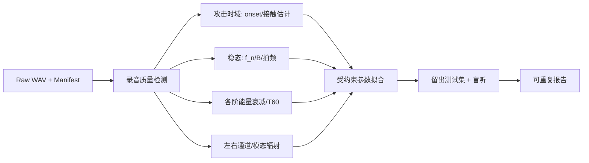

# 04｜研究计划、真实钢琴测量与参数反演

## 总原则

**物理可解释、测量可重复、实验可否证。** 只凭人耳听几秒不能判断模型是否真的接近钢琴。创建可以反复运行的 `piano_analyzer` 和 `piano_calibrator`，把声音变成可对比数据。

## 研究主题与假设

| 研究编号 | 可检验假设 | 最小实验 | 对产品的价值 |
|---|---|---|---|
| R01 | 非线性琴槌优于仅按力度缩放输出 | C4 多速度接触波形和谱质心 | 真正的动态演奏响应 |
| R02 | 弦刚性频散解释高次泛音偏移 | 跨 12 音符的部分音 `f_n` | 音色/音准真实性 |
| R03 | 频率相关损耗再现随时间的频谱变化 | Energy Decay Relief / 各阶 T60 | 自然延音 |
| R04 | 多弦耦合比独立叠加更像真实同音弦 | 拍频、两阶段衰减测量 | 和弦厚度 |
| R05 | 带机械阻抗的音板比纯后置 IR 更合理 | 负载变化后的弦衰减对比 | 音板-琴桥交互 |
| R06 | 可变制音器机械模型更自然 | 松键、半踏板、重踏板多场景 | 演奏真实感 |
| R07 | 模态弦模型在某些频段比波导更划算 | C2/C4/C7 的音质/CPU Pareto | 替代/混合算法决策 |
| R08 | 纵向/几何非线性是否具有可听收益 | 大力度盲听、残差频谱、CPU 对比 | 决定是否产品化 |

## 数据采集计划

### 设备与场地

- 一台维护良好、调律稳定的真实三角钢琴；记录品牌型号、序列编号可匿名、琴龄、环境温湿度、调律日期。
- 可重现的麦克风位置和增益；推荐至少一组近场立体声，一组声板/琴桥测量；必要时使用接触传感器（有条件时）。
- 机械化击弦系统或受控 MIDI 自演奏钢琴最佳；如果手工击弦，要在元数据中记录实际力度不可重复的不确定度。
- 无限制压缩、自动增益或逐条归一化。录音格式可用高于目标 DSP 采样率的原始 PCM，并记录 ADC、声卡、采样率和距离。
- 没有可用实物录音时使用合法来源音频开展分析，但明确限制，并且**不把商业音源的录音假设为真实物理参数真值**。

### 采样矩阵

1. 快速起步：C2、C3、C4、C5、C6、C7 及若干黑键共 **12 个代表音**；选择间隔与临界音区（单/双/三弦转换）附近的音符。
2. 每音三到五档击弦速度，每档至少三次；包括无踏板、延音踏板，必要时增加半踏板。
3. 每次至少有攻击、稳态、释放三个阶段；留出足够的自然衰减时间。
4. 加入和弦、复奏、silent key 共鸣和 half-pedal 作为第二阶段数据集。
5. 对所有文件计算 SHA-256，保存 `take_id`、采样率、参考 A4、音符、力度/执行机制、踏板、位置和合法授权备注。

## 特征提取流程

### 特征层次

- 时间：onset、10–90% 上升时间、短时 RMS、接触时长（如有传感器）、松键后衰减。
- 频率：逐阶泛音中心、非谐性 `B`、谱质心、非周期噪声/纵向波迹象。
- 包络：早/晚阶段不同泛音的衰减斜率，拍频强度/周期、残响时间。
- 空间：L/R 传递比例、互相关、声板空间频响（不把任意宽度效果当成真实声学）。

## 参数拟合目标（示意）

\[
\mathcal{L}(\theta)=
 w_f L_{partials}(\theta)+
 w_d L_{decay}(\theta)+
 w_a L_{attack}(\theta)+
 w_b L_{beating}(\theta)+
 w_s L_{spatial}(\theta)+
 \lambda R_{physical}(\theta).
\]

- 各项使用归一化且可解释的误差单位；具体权重必须通过留出数据集调整。
- `R_physical` 约束参数范围、跨音平滑、无源性、因果性、能量和稳定性。
- 采用分级拟合：**先频率和损耗，再琴槌及多弦，最后音板和空间**；避免所有参数同时拟合导致不可辨识。
- 记录局部最优、多个初始点结果、参数灵敏度与残差；不要把一次优化低损失误认为正确物理模型。

## 录音训练集与测试集

- 训练集：标定代表音与固定力度，用于参数拟合。
- 验证集：未参与拟合的力度、日期或麦克风位置，用于调权。
- 测试集：留出音符和演奏片段，用于盲听/验收。避免泄漏：同一录音切片不能同时进训练和测试。
- 输出每次模型版本、Git commit、数据清单哈希、实验种子、参数版本、音频样本和指标表。

## 盲听与演奏测试

设计 3 类：① 单音攻击/长音 A/B 或 ABX；② 音阶、连奏/复奏；③ 踏板、和弦和声场。通过相似响度匹配、随机顺序、双盲匿名文件减少偏差；不能把混响开启状态作为唯一评价。主观评分维度包括触键自然性、动态连续、音色钢琴感、低音衰减、共鸣逻辑、空间定位。

## 研究交付

每项 Rxx 都要生成：`hypothesis.md`、输入清单、`analysis.ipynb` 或 `.py`、数值报告 JSON、图表、A/B 音频、结论和下一步。无改善也要保留负面结果。
