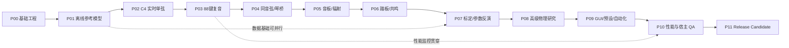

# 06｜开发路线图：P00–P11 与里程碑

## 总路线图

这是一条**推荐的工程验收顺序**，不是禁止并行。录音准备、实验指标、软件许可和持续性能监测必须从 P00/P01 贯穿整个项目。

## 阶段表

| 阶段 | 结果 | 核心交付 | 进入下一阶段条件 | 粗略投入（非承诺） |
|---|---|---|---|---|
| P00 | 可重复工程基线 | CMake + JUCE + CLI + CTest + AGENTS | Debug/Release 构建和最小宿主加载可证 | 3–7 天 |
| P01 | 离线物理参考 | 琴槌 ODE、理想/刚性弦参考、实验脚本 | 接触力/能量/频散对照可靠 | 2–4 周 |
| P02 | C4 实时演奏 | 双向波导、击弦点、分数延时、损耗 | 无 NaN、力度响应、频率可测 | 3–6 周 |
| P03 | 全音域复音 | 88 键参数框架、调律、分音区配置 | 全音域、和弦、重触发可靠 | 4–8 周 |
| P04 | 多弦与琴桥 | 1/2/3 弦结构、失谐、无源耦合 | 拍频与两阶段衰减，稳定性通过 | 4–8 周 |
| P05 | 音板与空间 | 模态共振器、辐射、机械端口反馈 | 音板开关 A/B，反馈不失稳 | 5–10 周 |
| P06 | 踏板和共鸣 | 制音器、CC64/66/67、共鸣弦 | 半踏板/重复按键/静音键测试 | 5–10 周 |
| P07 | 系统化标定 | 测量元数据、参数拟合、回归曲线 | 留出测试可复现、每音有出处 | 2–5 个月 |
| P08 | 高级真实度 | 纵向波/多极化/复杂 action A/B | 仅有可测收益才合并 | 1–3 个月，可选 |
| P09 | 完整软件体验 | GUI、预设、状态恢复、自动化 | 参数持久化、无 UI→音频阻塞 | 4–8 周 |
| P10 | 质量与性能 | profiler、pluginval、Validator、CI | 固定硬件负载和宿主测试通过 | 4–8 周 |
| P11 | 候选发行 | 安装、签名、授权、用户说明、回归 | 所有 RC 阻断项关闭 | 4–8 周 |

阶段用时与参与人力、录音设备、科研难度相关，不等于日期承诺；达到商业音源高真实度可能需要多轮 P04–P08 循环。

## 里程碑

- **M0（P00）：** 可独立构建并离线输出测试信号；证明环境，不代表物理模型完成。
- **M1（P02）：** 具有自然击弦、频散和随力度变化的 C4；保存三档 velocity WAV 与客观分析图。
- **M2（P04）：** 全音域和多弦拍频；可弹奏音乐片段。
- **M3（P06）：** 真实机制近似的音板/共鸣/踏板统一运行；由演奏者评估。
- **M4（P07/P08）：** 基于合法参考钢琴进行实测拟合和盲听；决定声学真实性是否达标。
- **M5（P11）：** 经宿主/授权/发行测试的 RC。

## 每一阶段必须提交

1. 代码/数据变更列表和 Git commit。
2. `cmake`/`ctest` 实际执行结果；失败项必须显示，不能虚报。
3. 声学基准/WAV/分析图或 `N/A + 原因`。
4. 实时限制测试、CPU 结果（有 DSP 代码时）；报告硬件配置。
5. 与上一版本的 A/B 比较、参数版本和数据来源。
6. `docs/decision-log/ADR-*.md` 或 `templates/ADR_TEMPLATE.md` 的决策记录。
7. `templates/PHASE_REPORT.md` 的完整总结和下一阶段风险。

## 阻断条件

- 自激/能量无界增长、NaN/Inf、不可重现 crash。
- 音频回调中锁等待/分配/同步文件 IO。
- 声称未运行的测试成功；以视觉演示代替实际声学输出。
- 无出处的关键物理参数被表述为实测值。
- 引入不兼容许可证代码或未经授权的原始录音。

## Codex 阶段指令索引

- [P00 工程基础](../codex/P00_项目基础与工具链.md)
- [P01 离线参考](../codex/P01_离线物理参考模型.md)
- [P02 单弦波导](../codex/P02_C4实时单弦引擎.md)
- [P03 全音域复音](../codex/P03_88键与复音.md)
- [P04 同音与琴桥](../codex/P04_多弦失谐与琴桥耦合.md)
- [P05 音板](../codex/P05_模态音板与声辐射.md)
- [P06 踏板](../codex/P06_制音器踏板与共鸣.md)
- [P07 标定](../codex/P07_测量数据与参数反演.md)
- [P08 高级研究](../codex/P08_非线性与高级模型评估.md)
- [P09 GUI](../codex/P09_界面预设与自动化.md)
- [P10 QA](../codex/P10_实时优化与宿主验证.md)
- [P11 发布](../codex/P11_发布候选与复测.md)
