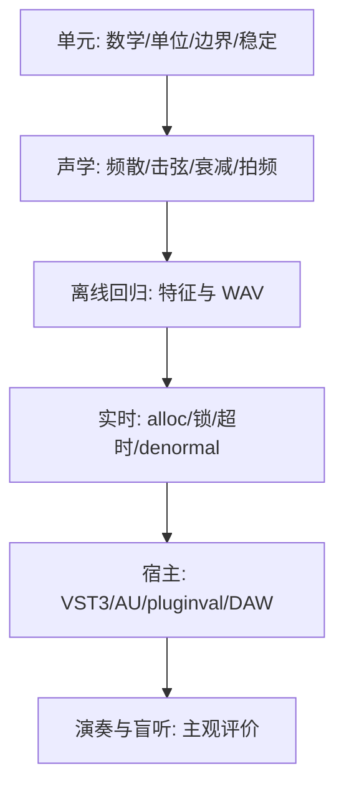

# 07｜测试矩阵与可量化验收

## 测试分层



## 自动化矩阵

| 测试代号 | 输入 | 证据 | 触发阶段 |
|---|---|---|---|
| T-UNIT-01 | 物理参数边界与单位 | 参数校验/报错测试 | P00+ |
| T-HAM-01 | 低中高 velocity 的撞击 | 接触时长、峰值力、连续谱变化 | P01+ |
| T-HAM-02 | 极端琴槌刚度、零/重复碰撞 | 能量、收敛、非有限值计数 | P01+ |
| T-STR-01 | 无外力理想弦 | 谱峰与基频 | P01+ |
| T-STR-02 | 刚性弦、多个 B 值 | 部分音偏移与误差曲线 | P02+ |
| T-STR-03 | 多频段损耗/T60 | 各阶衰减斜率和残差 | P02+ |
| T-VOICE-01 | 和弦/重叠 MIDI/重复 C4 | 无假音、状态连续、可播放 WAV | P03+ |
| T-BRIDGE-01 | 无源桥口、极端失谐 | 能量不增长、频谱拍频 | P04+ |
| T-BOARD-01 | 驱动共振、关闭驱动 | 模态稳定、预期衰减 | P05+ |
| T-PEDAL-01 | CC64/66/67、半踏板、静音键 | MIDI 轨迹 + WAV + 状态断言 | P06+ |
| T-FIT-01 | 独立保留的录音 | 部分音、衰减、动态误差报告 | P07+ |
| T-RT-01 | 高复音 + 踏板 + GUI 调参 | callback 分配/锁次数 0 | P02+ |
| T-RT-02 | 固定硬件 48kHz/64、128 块 | p50/p95/p99/max/掉音 | P03+ |
| T-HOST-01 | 加载卸载/状态回读/自动化 | Validator/pluginval 报告 | P09+ |
| T-OS-01 | Windows/macOS + 插件扫描 | CI / 手动测试记录 | P10+ |

## 声学指标：如何测量

- 音高：按明确的测试窗口估计基频，再用 `1200*log2(f_est/f_target)` 计算 cents 误差。*注意非谐性琴弦的感知音高与简单谱峰不同*。
- 非谐性：从多个部分音拟合 `B`，绘制 `fn_real - fn_model` 和频率权重残差；低强度部分音应有可信度阈值。
- 力度：按同一音量基准比较 RMS、谱质心、攻击噪声、衰减；禁止各档逐条峰值归一化。
- T60：记录算法、拟合时间窗和噪声底；自然振动的多阶段衰减应允许分段拟合。
- 拍频：观察调幅频率及随时间的频率包络，不以 Chorus 后处理充当耦合成果。
- 立体声：记录干声 L/R 能量、相关系数和可复现的麦克风/辐射参数。

## 性能测试设置模板

```yaml
hardware:
  cpu: "待填写"
  os: "待填写"
  power_mode: "待填写"
build:
  compiler: "待填写"
  mode: "Release"
  commit: "待填写"
audio:
  sample_rate: 48000
  block_sizes: [64, 128, 256]
  polyphony_scenarios: [1, 8, 32, 64]
  pedal: [off, sustain, sympathetic_heavy]
metrics: [p50_ms, p95_ms, p99_ms, max_ms, dropouts, rt_allocations]
```

固定块 `N/fs` 的物理期限是硬约束；70% 是建议的工程头寸而不是行业通行认证门槛。最大延迟受 OS/宿主调度影响，应同时测试离线渲染耗时和实际 DAW 下的 xrun。

## 禁止以 limiter 隐藏问题

安全限幅器可以保护监听，但不能作为稳定性测试的替代；测试要保留限幅前的内部能量统计。在断言失败时保存输入条件与参数快照，避免无法复现。

## 听音测试可复现记录

- 参与者数量和演奏经验分层、设备、耳机/监听、响度校准。
- 随机化音频编号；统一响度，不以音量高低决定偏好。
- 按音区、力度、音乐段落、踏板四类评分；在不泄露分组情况下保存原始回答。
- 报告置信区间/离群数据；主观偏好不应被解释成物理模型绝对正确。

## 发布 QA

- Steinberg Validator：插件接口、总线、状态、处理边界。
- Tracktion pluginval：扫描、载入、状态、参数随机化、窗口与稳定性。
- DAW 实测：至少两种主流 DAW（按目标平台），工程保存重开、离线导出、采样率切换、禁用/启用和 MIDI CC。
- macOS 需 AU 检验、签名/公证测试（如发布）；Windows 需安装卸载/签名策略。

## 门槛状态

所有测试要标明 `PASS / FAIL / SKIP / NOT RUN`，后两者必须有原因。未运行不等于通过；监听认为好听不等于通过数值和 RT 安全测试。
